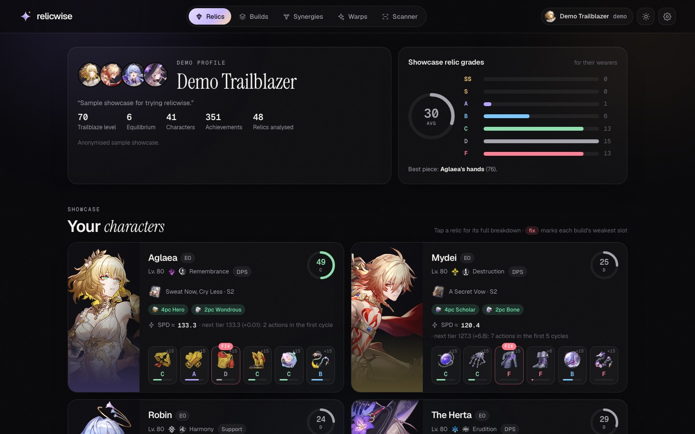
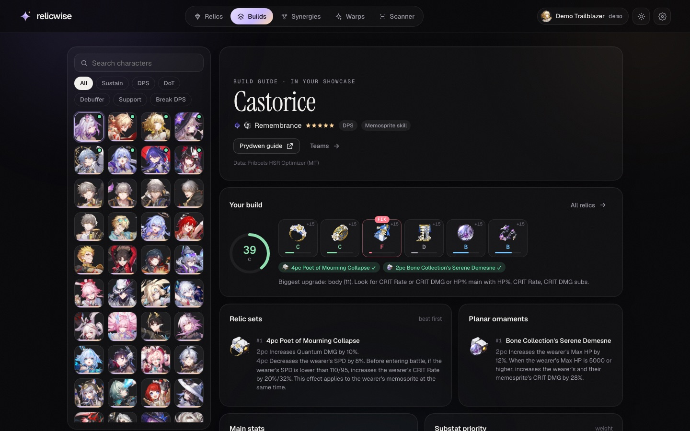
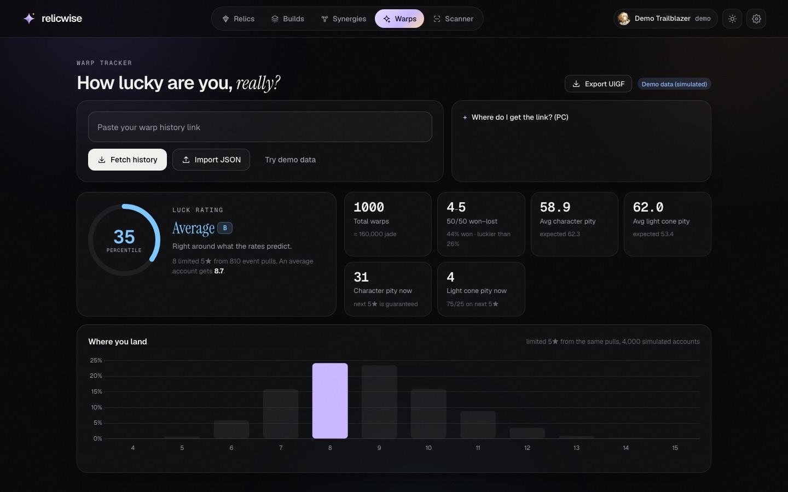
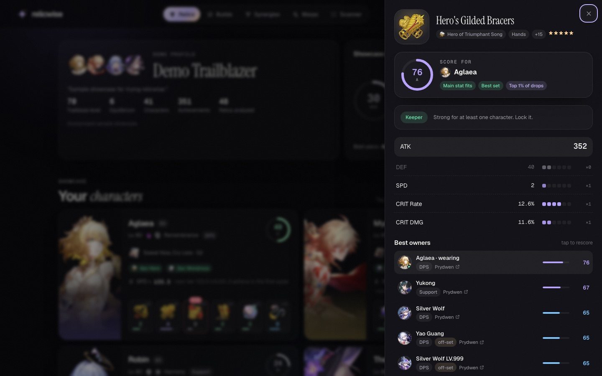

<p align="center">
  
</p>
<h1 align="center">relicwise</h1>
<p align="center"><b>Relic intelligence for Honkai: Star Rail.</b><br>
Grade every relic against every character, find each piece's best owner, plan speed tiers,<br>
scan relics straight off your screen, and find out how lucky your warps really were.</p>

<p align="center">
  <a href="#getting-started">Run it</a> ·
  <a href="#what-makes-relicwise-different">Why it's different</a> ·
  <a href="#how-the-scores-work">How scoring works</a> ·
  <a href="#deploying">Deploy</a>
</p>



Most relic raters answer one question: *how good is this piece on the character wearing it?* relicwise answers the
questions that come after it. Who **should** be wearing it? Is a +0 piece worth the EXP? Is it actually rare, or
just okay? Which slot is holding the build back, and what exactly should replace it? Am I 0.01 SPD short of a
speed tier?

It's a static site (plain HTML, CSS and ES modules, no build step) backed by an 80-line proxy. Everything is
computed in your browser.

---

## What makes relicwise different

### 1. Every relic is scored for every character
Each piece is ranked across the whole roster (93 characters, including enhanced kits and the newest releases),
not just its wearer. Every row shows whether the main stat fits, whether the set is recommended, and a link to that
character's Prydwen guide. Tap any character to rescore the piece through their eyes.

### 2. Roll-aware scoring, not stat totals
relicwise reads the exact roll count behind every substat (Enka exposes the affix rolls, and the scanner reconstructs
them). Scores are measured in **max rolls**, so 5.8% CRIT Rate and 11.6% CRIT DMG count equally because both are
two rolls. Roll pips in the detail view show where each relic's upgrades actually landed.

### 3. “Better than X% of drops”
Letter grades are relative to a perfect relic, which almost nothing reaches. So relicwise also simulates
3,000 fully levelled drops with the same main stat (real substat odds, 3/4-line starts, low/mid/high rolls) and tells
you where yours lands: *top 1% of drops* means lock it forever.

### 4. Upgrade odds for unlevelled relics
For anything below +15, relicwise enumerates every way the remaining upgrades can land (exact multinomial odds, plus
which 4th line a 3-line relic can gain) and reports the **expected final score**, the **best case**, and the
**chance of reaching A or better**. Then it gives a verdict: *Keeper*, *Level it*, *Gamble* (level to the next
checkpoint and re-check), or *Fodder*.

### 5. Weakest-link detection with a shopping list
Each build gets a score, and its weakest slot is flagged. The advice is specific: *“Biggest upgrade: rope (23). Look
for ATK% main with SPD, CRIT Rate, CRIT DMG subs.”*

### 6. Exact speed tiers
Speed estimates include relics, traces and set bonuses (including penalties such as Poet of Mourning Collapse's −8%).
Breakpoints come from action-value math (k actions in the first N cycles), so you see *“next tier 142.9 (+0.41): 5 actions
in the first 3 cycles”* instead of folklore numbers.



### 7. A screen scanner that doesn't care about your resolution
Share your game window (or drop screenshots) and click through your inventory. The scanner
- **finds the relic by its name.** Every piece name belongs to exactly one set and slot, so there are no fixed
  pixel positions or templates.
- **sizes the stat region from the detected text height**, so 720p, 4K and ultrawide all work.
- **validates every number against the game's roll table.** That recovers roll counts and repairs the classic
  OCR miss of a dropped decimal point (`77%` → `7.7%`), and flags the value for you to check.

It runs entirely in the browser (Tesseract.js + WebAssembly), so nothing is uploaded and nothing is installed.
Tested on synthetic panels at 1280×720, 1920×1080, 2560×1440 and 3440×1440: about 1.2 s for a full-frame read and
about 0.5 s once the panel is locked.

### 8. Warp luck as a real percentile
Average pity on its own doesn't tell you much. relicwise replays your exact pulls on each event banner through
4,000 simulated accounts (soft pity, 50/50 and 75/25, guarantees) and reports your **luck percentile**, from
*Cursed* to *Blessed*. You also get your 50/50 record with its own odds, avg pity vs expected, current pity and
guarantee status, and per-banner pity charts with every win, loss and guarantee colour-coded.



### 9. Synergies that know your roster
Recommended teams from optimizer simulations, frequent partners, the teams a character *also slots into*
(reverse lookup), and the teams you can field from your own showcase.

### 10. Always current, honest about its sources
Build data (stat weights, main stats, sets, teams, signature light cones) comes from the actively maintained
[Fribbels HSR Optimizer](https://github.com/fribbels/hsr-optimizer) (MIT) and game data from
[StarRailRes](https://github.com/Mar-7th/StarRailRes). A weekly GitHub Action rebuilds both and **opens a pull
request** for review. Characters without optimizer data yet fall back to a kit-based build inferred from their
traces, and the UI labels them that way.

| | Typical relic rater | relicwise |
|---|---|---|
| Who it scores for | The wearer | Every character, ranked |
| Substats | Stat totals × weights | Exact rolls, in max-roll units |
| Context for a score | Letter grade | Grade + percentile vs simulated drops |
| Unlevelled relics | Current score | Expected / best case / P(A+) + verdict |
| Speed | Total SPD | SPD estimate + exact action-value breakpoints |
| Relic import | Desktop scanner app | In-browser, any resolution, nothing uploaded |
| Warp luck | Average pity | Percentile vs 4,000 simulated accounts |



---

## How the scores work

For a character with substat weights *w* (from the optimizer; flat ATK/HP/DEF count 40% of a percent roll):

```
score   = Σ  w(stat) × value / maxRoll(stat)                  ← weighted value in max rolls
ideal   = 6·w₁ + w₂ + w₃ + w₄                                 ← best possible relic with the same main stat
percent = score / ideal × 100
fit     = percent × mainStatFit × setFit                      ← what the grades and rankings use
```

- `mainStatFit` is 1 when the main stat is one the build wants, and 0.3 when it isn't. Slots the optimizer leaves
  open score 0.75–1 depending on the main stat's weight.
- `setFit` is 1 for the best set, 0.95–0.97 for other recommended sets, 0.8 off-set (0.75 for off-set planars).
- Grades: **SS** ≥ 92 · **S** ≥ 80 · **A** ≥ 65 · **B** ≥ 50 · **C** ≥ 35 · **D** ≥ 20 · **F**.
  As a guide, four useful lines with average luck is about 85, three is about 64, and two is about 46.

The warp model uses the published base rates with the community-measured soft-pity ramp (characters 0.6% → ramp from
pull 74, hard pity 90, 50/50; light cones 0.8% → ramp from pull 66, hard pity 80, 75/25).

---

## Getting started

Requirements: Python 3 (built into macOS) and any modern browser. Nothing to install.

```bash
python3 tools/dev_server.py        # http://localhost:8000
```

The dev server serves the site **and** the two proxy routes (`/api/enka/<uid>`, `/api/gacha`), so UID lookups and
warp sync work locally with no setup. Want to look around first? Open **`/#/demo`** for a sample showcase and
**`/#/warps/demo`** for simulated warp history.

| Command | What it does |
|---|---|
| `python3 tools/dev_server.py` | Local site + proxy (`--port` to change) |
| `node tests/run.js` | Logic tests: roll math, scoring, potential, Enka parsing, warp analysis, OCR parsing |
| open `/tests/ocr.html` | Browser OCR regression test at four resolutions |
| `python3 tools/build_data.py` | Rebuild `data/*.json` from StarRailRes + the optimizer |

### Getting your warp history link (PC)
1. In game, open **Warp → View Details → Records** once.
2. In PowerShell, run the command shown on the Warps tab (`irm <site>/tools/get-warp-url.ps1 | iex`).
   [The script](tools/get-warp-url.ps1) reads the game's local web cache, checks the link with HoYoverse, and copies
   it to your clipboard. It sends nothing anywhere else.
3. Paste it into relicwise. Links expire after about a day. The game only keeps 6 months of history, but relicwise
   keeps everything it has synced in your browser. You can also import or export **UIGF v4** (and import SRGF).

---

## Deploying

relicwise is two pieces: the static site (GitHub Pages) and a tiny proxy (Cloudflare Workers, free tier). The proxy
exists because Enka.Network and HoYoverse's warp API don't send CORS headers, so browsers can't call them directly.

**1. Proxy** ([`worker/`](worker/))
```bash
cd worker
npx wrangler deploy          # needs Node 18+; or paste index.js into a new Worker in the Cloudflare dashboard
```
Edit `ALLOWED_ORIGINS` in [`worker/wrangler.toml`](worker/wrangler.toml) to your site's origin(s). The worker
forwards exactly two upstreams, caches Enka responses for the TTL Enka sets, never caches or logs warp auth keys,
and rejects requests from other sites.

**2. Site**: set `proxy` in [`js/config.js`](js/config.js) to your worker URL (visitors can also set it in
⚙ Settings), then enable GitHub Pages on the repo root. For a custom domain, add a `CNAME` file (e.g.
`relicwise.jzeng.io`) and the matching DNS record.

**3. Data refresh**: enable *“Allow GitHub Actions to create and approve pull requests”* so the weekly
[refresh workflow](.github/workflows/refresh-data.yml) can open its PR.

---

## Privacy
- UID lookups go to Enka.Network through your proxy. Only public showcase data is used.
- Warp links go only to HoYoverse's official API through your proxy. The worker never stores or logs them, and the
  dev server redacts `authkey` from its logs.
- The scanner runs locally. Your screen is never uploaded.
- Profiles, warp history and scans live in your browser's localStorage. ⚙ Settings clears each one.

## Limitations
- Enka only exposes the (up to) 8 characters on your in-game showcase. Use the scanner for the rest of your inventory.
- Prydwen has no API and blocks automated access, so relicwise links to each character's Prydwen guide instead of
  copying its content. Links are built from character names, so a few unusual slugs may miss.
- Collaboration-banner warps are fetched best-effort (`getLdGachaLog`). If a region doesn't serve them, they're skipped.
- The standard-pool list (for 50/50 detection) is built in and extended automatically with any 5★ you pulled on the
  standard banner.
- SPD estimates ignore light cone passives and conditional set effects.
- The scanner expects the game's English UI and is in beta. Values it had to repair are flagged for checking.

## Project structure
```
index.html, css/styles.css    shell + design system (dark/light, motion, responsive)
js/app.js                     routing, tabs, theme, settings
js/views/*.js                 home, relics, builds, synergies, warps, scan
js/scoring.js                 scoring, potential, drop percentile, speed tiers
js/stats.js                   stat vocabulary + roll math
js/enka.js, js/warps.js       data sources + warp analysis/simulation
js/ocr.js                     resolution-agnostic relic scanner
data/                         generated game/build data (+ demo profile)
tools/                        data builder, dev server, warp-link script
worker/                       Cloudflare Worker proxy
tests/                        node + browser tests
```

## Credits & licenses
- Game data and images: [Mar-7th/StarRailRes](https://github.com/Mar-7th/StarRailRes) (AGPL-3.0). `data/game.json`
  is derived from it.
- Build data: [fribbels/hsr-optimizer](https://github.com/fribbels/hsr-optimizer) (MIT). See
  [`data/LICENSE-builds.md`](data/LICENSE-builds.md).
- Profiles: [Enka.Network](https://enka.network). OCR: [Tesseract.js](https://github.com/naptha/tesseract.js).
  Charts: [Chart.js](https://www.chartjs.org).

relicwise is a fan project and is not affiliated with or endorsed by HoYoverse. Honkai: Star Rail and all related
names and images are trademarks and copyrights of HoYoverse.
